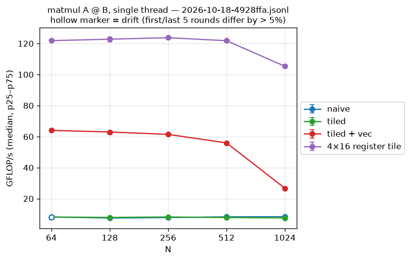
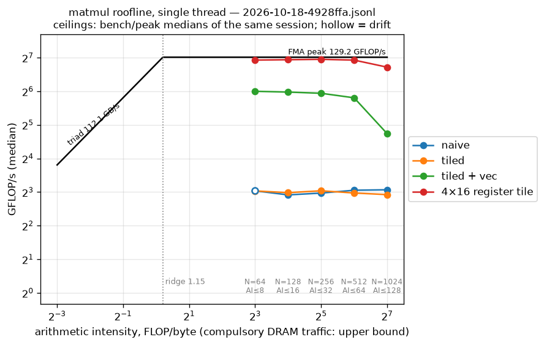
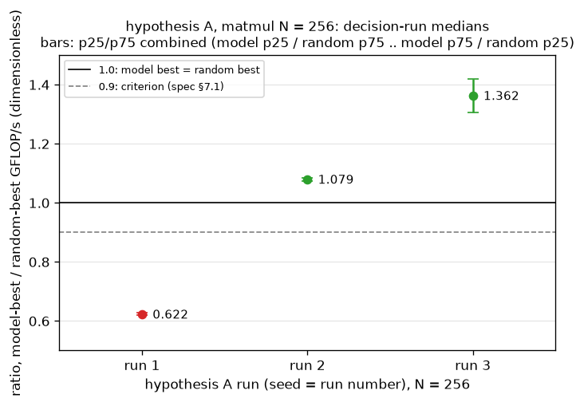
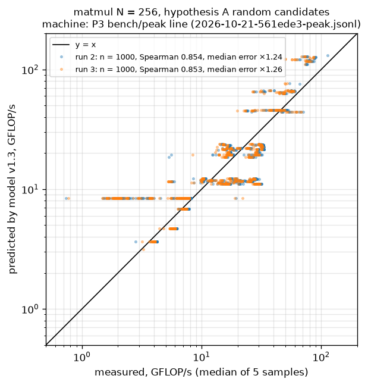

**English** | [Русский](README.ru.md)

# coffee-ten

A tiny tensor compiler, and a test of whether an analytic cost model can replace most of a
random schedule search.

## Abstract

coffee-ten compiles a small Python tensor graph through a graph IR and a loop IR with a
textual schedule (split, reorder, vectorize, unroll) to C, which clang turns into a CPU
kernel. We ask whether an analytic cost model (cache traffic from loop footprints plus a
roofline with load/store and FMA-latency ceilings) ranks schedules well enough that its top
10 contains a schedule within 90% of the best of 1000 random measurements (hypothesis A).
On one Apple M5 core at N = 256, the first run failed (ratio 0.622); after fixes to the
harness and the model, run 2 met the criterion (ratio 1.079) and run 3,
on a new random sample, met it out of sample (ratio 1.362), with Spearman 0.853 and a
median error of ×1.26 between model and measurement over 1000 random schedules
([run 1](BENCHMARKS.md#hypothesis-a-spec-71-run-1-not-met),
[run 2](BENCHMARKS.md#hypothesis-a-spec-71-run-2-met),
[run 3](BENCHMARKS.md#hypothesis-a-spec-71-run-3-met-out-of-sample)). Run 4, with model v1.8
and a new sample, met it by a small margin (ratio 1.022; Spearman 0.915, median error ×1.13;
[run 4](BENCHMARKS.md#hypothesis-a-spec-71-run-4-met-c4-out-of-sample-two-of-three-groups)).
A hand-written 4×16 register-tile schedule reaches 94–96% of the measured FMA peak for N ≤ 512
([Register tile](BENCHMARKS.md#register-tile-s3)). One machine and one problem size have been
tested.

## 1. Introduction

Tensor compilers separate what to compute (a graph) from how to compute it (a schedule)
[3], [5], and pick schedules by search, often guided by a learned cost model [11], [12].
coffee-ten is a deliberately small compiler of this kind (single-thread CPU, static shapes,
C backend) built to test one question: can an *analytic* model, with no training data,
rank the schedules of a single-thread f32 matmul well enough to replace most of a random
search? The criterion, fixed in advance (spec §7.1), is hypothesis A: the model's top 10
holds a schedule within 90% of the best of 1000 random measurements.

Contributions: a compiler whose kernels match a reference interpreter bit for bit when a
schedule keeps the order of sums, and within a derived error bound [14] otherwise
([§2.1](#21-compiler)); an analytic cost model ([§2.3](#23-cost-model)); and four
recorded runs of hypothesis A with the raw data committed ([§3](#3-results)).

## 2. Method

### 2.1 Compiler

A Python `Tensor` records a graph (tracing, [8], [10]); the graph is a static-shape SSA
DAG lowered to loop IR, where a chain of elementwise ops becomes one loop nest and `matmul`
becomes an init nest and an `i, k, j` update nest. A schedule transforms the loop IR, the
backend emits C, and clang compiles it into a kernel loaded with libloading. The reference
interpreter (`ct.run`) is the oracle for every compiled kernel. Details and the code that
checks each step: [Appendix B](#appendix-b-basis).

### 2.2 Schedules

A schedule is text: steps separated by `;`. A step names a nest by number and loops by
name.

- `split(nest, loop, outer, inner, factor)`: `loop` becomes `outer` and `inner`, with
  `inner` of extent `factor`; a guard covers a remainder.
- `reorder(nest, loop, ...)`: the new loop order of the nest, outermost first; it must
  list every loop once.
- `vectorize(nest, loop)`: `loop` must be the innermost loop, not a reduction loop, and
  have stride 1 in the output.
- `unroll(nest, loop)`: any loop, also the vectorized one, if its extent is at most 64 and
  it is not unrolled yet. Like `vectorize` it is a request to clang (`unroll(full)`).

Nests are numbered from 0 in `ct.loop_ir` order. In the example, nest 0 zero-fills the
matmul result, nest 1 is the `i, k, j` update that `split` targets, and nest 2 is the
relu. An illegal step raises `ValueError` with the step number.

`Kernel.order_class` says what a schedule may change:

- `preserving`: every output element gets its contributions in the same order, so the
  result equals `ct.run` bit for bit.
- `reordering`: the order of a float sum changes, so the result is equal only within the
  bound in [14] (see Basis).

### 2.3 Cost model

The model (`crates/coffee-ten-bench/src/model.rs`, v1.8) predicts GFLOP/s of the matmul
update nest without running it. Cache traffic is computed from the footprint of each loop
level; the compute ceiling is the lowest of the FMA peak, a load/store ceiling (accesses of
`C` stay in memory unless held in registers) and a latency ceiling for dependent FMA chains;
the prediction is the roofline [1] minimum of compute and traffic. Machine numbers are
inputs, read from a `bench/peak` line ([Ceilings](BENCHMARKS.md#ceilings-benchpeak-one-core)).
Fixes after run 1, frozen before the next run: short "vectorized" loops modelled as scalar
(#57), FMA latency ceilings (#58, #59, v1.2), loops clang fully unrolls (#63, v1.3).
Fixes after run 3 (v1.4–v1.8): separate load and store ceilings (#82, `fma_store`),
unrolled scalar bodies (#85, `fma_mem_acc_scalar_unrolled`),
column reload (#90, `fma_col_reload`), unrolled column load (#93, #94, `fma_col_unrolled`),
and a short vectorized loop as one vector iteration (#97, after the codegen of #96; no new
point); see [Model group errors after C4](BENCHMARKS.md#model-group-errors-after-c4-v14v17).
`coffee-ten-bench model compare --from <results.jsonl>` prints the model against
measurements, with Spearman rank correlation and median error.

### 2.4 Measurement

`bench/run.sh` takes the numbers on an idle Mac, on AC power, from a clean commit; it
runs `matmul` and `relu-matmul-bias` for N from 64 to 1024 and writes
`bench/results/<date>-<commit>.jsonl`. Besides the naive kernel it measures the tiled
schedule, the same vectorized, and a 4x16 register tile (`unroll` on `ii` and `ji`).
The numbers so far are in BENCHMARKS.md.
Every variant is checked against the naive kernel within the error bound before it is
timed; each (kernel, N) gets a warm-up and 30 interleaved rounds, and the median and
p25–p75 are reported ([Conditions](BENCHMARKS.md#conditions)).

Hypothesis A (N = 256, 7334-schedule space): 1000 random candidates and the model's top 10
are measured; the best of each group then runs in one interleaved decision run of 30
rounds, and the ratio is model-best / random-best median GFLOP/s.

## 3. Results

**Single-schedule speed** ([Matmul](BENCHMARKS.md#matmul-a--b), [What the numbers say](BENCHMARKS.md#what-the-numbers-say)).
Vectorizing the tiled matmul takes it from about 7 to 57–60 GFLOP/s, 47–50% of the measured FMA peak, for N ≤ 256; it falls to
37% at N = 512 and 20% at N = 1024; tiling alone gains at most 8%. The 4×16 register tile
reaches 94–96% of peak for matmul at N ≤ 512 and 81% at N = 1024 (fused
relu(A @ B + bias): 78–91%; one session, S3).



**Fig. 1.** Matmul GFLOP/s against N for the four schedules (naive, tiled, tiled + vec,
4×16 register tile), session S3, median with p25–p75; hollow markers are variants flagged
`drift`. Raw data `bench/results/2026-10-18-4928ffa.jsonl`; `python3 bench/plot.py`.



**Fig. 2.** Roofline [1] of the same S3 points. Ceilings are S3's own `bench/peak` medians,
FMA 129.2 GFLOP/s and memory triad 112.1 GB/s (ridge 1.15 FLOP/byte). Arithmetic intensity
is N / 8 FLOP/byte on compulsory DRAM traffic, an upper bound on the real AI of each variant
([details](BENCHMARKS.md#benchmarks)); `python3 bench/roofline.py`.

**Hypothesis A**, all at N = 256:

- Run 1 (#56): ratio 0.622, not met. Spearman 0.292 over the random candidates, a
  number later found biased by the harness ([run 1](BENCHMARKS.md#hypothesis-a-spec-71-run-1-not-met)).
- Model and harness fixes after run 1: short "vectorized" loops modelled as scalar (#57),
  FMA latency ceilings (#58, #59, model v1.2), a 300 ms time-based warm-up (#61), loops
  clang fully unrolls (#63, model v1.3).
- Run 2 (#62): ratio 1.079, met (model v1.2, Spearman 0.571)
  ([run 2](BENCHMARKS.md#hypothesis-a-spec-71-run-2-met)).
- Run 3 (#64): ratio 1.362, met out of sample on a new seed (model v1.3, Spearman 0.853,
  median error ×1.26) ([run 3](BENCHMARKS.md#hypothesis-a-spec-71-run-3-met-out-of-sample)).
- Run 4 (#98): ratio 1.022, met by a small margin (model v1.8, Spearman 0.915, median error
  ×1.13). It is the first run with the short-loop codegen (#96): random search now meets
  register tiles early. The top 10 was chosen by v1.7 (the run started from a checkout
  before #97); v1.8 has the same rank 1
  ([run 4](BENCHMARKS.md#hypothesis-a-spec-71-run-4-met-c4-out-of-sample-two-of-three-groups)).
- Model-guided local search over one-step schedule neighbours (#65): code only, no
  measured run yet.



**Fig. 4.** Hypothesis A ratio per run: median GFLOP/s of the best of the model's top 10
over that of the best of 1000 random candidates, both from the run's interleaved decision
run (30 rounds); bars combine the p25–p75 of both. Run 1 0.622, run 2 1.079, run 3 1.362,
as in [BENCHMARKS.md](BENCHMARKS.md#hypothesis-a-spec-71-run-1-not-met). Solid line 1.0
(model best = random best), dashed 0.9 (the criterion). Raw data
`bench/results/*hypothesis-a*.jsonl`; `python3 bench/hypothesis_ratio.py`.

C4 status: the three model errors of run 3 (vectorized `ji` = 32/64 ×1.50, scalar `ii`
innermost ×1.42, short "vectorized" loops ×0.73) were to be brought into [0.83, 1.20]. In
sample, on run 3 with v1.7, they are 1.171 / 1.147 / 1.122. Out of sample, on run 4 with
v1.8, they are 1.109 / 1.227 / 1.091: the `ji` ≤ 16 group misses. The cause is the column
reload of v1.6 in vector code, which the model does not cover; a hand microbenchmark
reproduces run 4's rates (#99). Open
([run 4](BENCHMARKS.md#hypothesis-a-spec-71-run-4-met-c4-out-of-sample-two-of-three-groups)).

One command reproduces the run 4 numbers (model v1.8, P7 `bench/peak` line):

```sh
cargo run --release -p coffee-ten-bench -- model compare \
  --from bench/results/2026-10-30-hypothesis-a-run4.jsonl \
  --peak bench/results/2026-10-28-adcf09c-peak.jsonl --group random
```

It prints `Spearman rank correlation 0.915; median |ln(predicted/measured)| 0.125 (a factor
1.13)` and the group table of BENCHMARKS.md, row for row.



**Fig. 3.** Model v1.3 prediction against measurement for the 1000 random candidates of
hypothesis A run 2 (blue) and run 3 (orange), matmul N = 256, log-log, line y = x. Run 2:
Spearman 0.854, median error ×1.24 (in sample for v1.3); run 3: Spearman 0.853, median
error ×1.26 (out of sample). Machine numbers from the P3 `bench/peak` line
(`bench/results/2026-10-21-561ede3-peak.jsonl`), on which both runs were taken. Points and
numbers are the output of `coffee-ten-bench model compare`, the same as in
[BENCHMARKS.md](BENCHMARKS.md#hypothesis-a-spec-71-run-3-met-out-of-sample);
`python3 bench/model_scatter.py`.

## 4. Limitations

Scope of the evidence: one machine (Apple M5, one core), one size (N = 256) for hypothesis
A, seeds 1, 2, 3 (runs 1–3) and 5 (run 4). Open: the vector column reload (the `ji` ≤ 16
group above), and a run at another N. Threats to validity of the measurements:
[Validity](BENCHMARKS.md#validity).

Compiler limitations:

- `f32` only in Python. The interpreter has an f64 mode that the binding does not expose.
- Static shapes: `ct.input` takes a fixed shape; nothing is dynamic.
- Single thread: the generated C has no threads.
- CPU only: the C backend is built with clang; there is no GPU path.
- Python operators: `+ - * /`, unary `-`, `ct.relu`, `ct.maximum`, `ct.exp`, and `@` or
  `ct.matmul` on 2-D tensors; `ct.softmax` is built from them.
- Reductions are last-axis `ct.sum` and `ct.max` only, keeping the axis with size 1.
- `exp` calls the platform libm (within 1 ulp, not correctly rounded), so graphs with
  `exp` are checked against float64 within a derived bound, not bit for bit.
- clang must be on `PATH` when `ct.compile` runs; without it, `ct.compile` raises
  `RuntimeError`.
- Tested on Linux (`ubuntu-latest`) and macOS (`macos-latest`, on pushes to `main` and
  manual runs only); no Windows in CI.
- Loop IR nests are perfect: one store under one loop chain. A relu or bias after a
  matmul is its own nest; there is no epilogue fusion yet.

### Non-goals

Competing with BLAS, TVM, XLA or Inductor; training and autograd; sparse tensors;
dynamic shapes; convolutions and attention; types other than `f32`; a custom
language; ONNX or torch.fx import; MLIR and LLVM; threads and GPU in the MVP.

## References

DOIs checked against Crossref (api.crossref.org) on 2026-10-24. Entries without a DOI
(blog post, OSDI, NeurIPS and SysML papers, software, a course) link to the source instead.

- [1] S. Williams, A. Waterman, D. Patterson. Roofline: an insightful visual
  performance model for multicore architectures. *CACM* 52(4), 2009.
  https://doi.org/10.1145/1498765.1498785
- [2] S. Boehm. Fast Multidimensional Matrix Multiplication on CPU from Scratch.
  Blog post, 2022. https://siboehm.com/articles/22/Fast-MMM-on-CPU
- [3] J. Ragan-Kelley, C. Barnes, A. Adams, S. Paris, F. Durand, S. Amarasinghe.
  Halide: A Language and Compiler for Optimizing Parallelism, Locality, and
  Recomputation in Image Processing Pipelines. PLDI 2013.
  https://doi.org/10.1145/2491956.2462176 (CACM version:
  https://doi.org/10.1145/3150211)
- [4] T. Chen, T. Moreau, Z. Jiang, L. Zheng et al. TVM: An Automated End-to-End
  Optimizing Compiler for Deep Learning. OSDI 2018. https://arxiv.org/abs/1802.04799
- [5] S. Feng, B. Hou, H. Jin, W. Lin et al. TensorIR: An Abstraction for
  Automatic Tensorized Program Optimization. ASPLOS 2023.
  https://doi.org/10.1145/3575693.3576933 (preprint: https://arxiv.org/abs/2207.04296)
- [6] K. Goto, R. A. van de Geijn. Anatomy of High-Performance Matrix
  Multiplication. *ACM TOMS* 34(3), 2008. https://doi.org/10.1145/1356052.1356053
- [7] J. Ansel, E. Yang, H. He, N. Gimelshein et al. PyTorch 2: Faster Machine
  Learning Through Dynamic Python Bytecode Transformation and Graph Compilation.
  ASPLOS 2024. https://doi.org/10.1145/3620665.3640366
- [8] tinygrad. https://github.com/tinygrad/tinygrad
- [9] C. Lattner, M. Amini, U. Bondhugula, A. Cohen et al. MLIR: Scaling Compiler
  Infrastructure for Domain Specific Computation. CGO 2021.
  https://doi.org/10.1109/CGO51591.2021.9370308
- [10] R. Frostig, M. J. Johnson, C. Leary. Compiling machine learning programs
  via high-level tracing. SysML 2018.
  https://mlsys.org/Conferences/2019/doc/2018/146.pdf
- [11] T. Chen, L. Zheng, E. Yan, Z. Jiang et al. Learning to Optimize Tensor
  Programs. NeurIPS 2018. https://arxiv.org/abs/1805.08166 ; L. Zheng, C. Jia,
  M. Sun, Z. Wu et al. Ansor: Generating High-Performance Tensor Programs for Deep
  Learning. OSDI 2020. https://arxiv.org/abs/2006.06762
- [12] A. Adams, K. Ma, L. Anderson, R. Baghdadi, T.-M. Li et al. Learning to
  Optimize Halide with Tree Search and Random Programs. *ACM TOG* 38(4), 2019.
  https://doi.org/10.1145/3306346.3322967
- [13] U. Bondhugula, A. Hartono, J. Ramanujam, P. Sadayappan. A practical
  automatic polyhedral parallelizer and locality optimizer. PLDI 2008.
  https://doi.org/10.1145/1375581.1375595
- [14] N. J. Higham. *Accuracy and Stability of Numerical Algorithms*, 2nd ed.
  SIAM, 2002. https://doi.org/10.1137/1.9780898718027
- [15] T. Chen, T. Dettmers. CMU 10-414/714: Deep Learning Systems (Needle).
  https://dlsyscourse.org/

## Appendix A. Quickstart

Needs Rust (the version in `rust-toolchain.toml`; `rustup` installs it), clang on
`PATH`, and Python 3.9 or newer. pip pulls in NumPy.

```sh
cargo test --workspace
pip install ./crates/coffee-ten-py
```

```python
import numpy as np
import coffee_ten as ct

A = ct.input("A", (4, 3))
B = ct.input("B", (3, 8))
bias = ct.input("bias", (8,))
y = ct.relu(A @ B + bias)

rng = np.random.default_rng(0)
inputs = {
    "A": rng.standard_normal((4, 3), dtype=np.float32),
    "B": rng.standard_normal((3, 8), dtype=np.float32),
    "bias": rng.standard_normal(8, dtype=np.float32),
}

print(ct.loop_ir(y))
k = ct.compile(y, schedule="split(1, j, jo, ji, 4); vectorize(1, ji)")
out = k(**inputs)
ref = ct.run(y, **inputs)
assert np.array_equal(out.view(np.uint32), ref.view(np.uint32))
print("match:", k.order_class)
```

Output, shortened:

```text
kernel kernel(A: f32[4, 3], B: f32[3, 8], bias: f32[8], t0: f32[4, 8], out: f32[4, 8])
for i in 0..4:
...
match: preserving
```

## Appendix B. Basis

Each section names the idea the code rests on, where it lives and what checks it.
`planned` means not implemented yet. Numbers in brackets refer to [References](#references).

### Algorithm vs schedule — [3], [5]

What to compute is a graph; how to compute it is a schedule, a list of named
loop-IR transformations (`split`, `reorder`, `vectorize`). Each step either keeps
the program legal or returns an error. Loop indices are affine expressions [9].
Code: `crates/coffee-ten-loop/src/schedule.rs` (text form),
`crates/coffee-ten-loop/src/apply.rs` (split, reorder, vectorize). Checked by:
trace-equality proptests in `crates/coffee-ten-loop/src/apply.rs`;
`crates/coffee-ten-codegen-c/tests/reorder.rs` and
`crates/coffee-ten-codegen-c/tests/vectorize.rs`.

### Graph IR and fusion — [4], [7]

A static-shape SSA DAG. A chain of elementwise ops lowers to one loop nest, so it
is fused for free; `matmul` is its own node. The backend emits C source, not
LLVM IR. Code: `crates/coffee-ten-ir/src/graph.rs`;
`crates/coffee-ten-loop/src/lower.rs` (an elementwise chain becomes one nest; matmul
becomes init and update nests); `crates/coffee-ten-codegen-c` (C source, clang,
libloading). Checked by: `lower.rs` tests;
`crates/coffee-ten-codegen-c/tests/end_to_end.rs` (compiled kernels equal the
interpreter bit for bit).

### Loop tiling for matmul — [2], [6]

`split` and `reorder` give cache tiles, `vectorize` widens the innermost `j` loop.
Packing is not implemented. There is no separate micro-kernel either: a register tile
is an ordinary schedule, `split` + `reorder` + `vectorize` + `unroll` (the 4×16 tile in
`bench/run.sh`), and clang keeps that tile of C in vector registers across `k`. Code: the matmul update nest is lowered in `i, k, j`
order (`crates/coffee-ten-loop/src/lower.rs`); tiles come from `split` and `reorder`,
and the `j` loop is vectorized (`crates/coffee-ten-loop/src/apply.rs`). Checked by:
`crates/coffee-ten-codegen-c/tests/vectorize.rs` (clang's `-Rpass=loop-vectorize`
remarks), `crates/coffee-ten-codegen-c/tests/reorder.rs` and
`crates/coffee-ten-codegen-c/tests/unroll.rs` (the register tile, in the optimized IR). Speed: measured by
`crates/coffee-ten-bench` (variants interleaved over rounds, median and IQR), one run of
all sizes with `bench/run.sh`;
numbers in BENCHMARKS.md.

### Legality of loop reordering — [13]

`reorder` permutes the loops of one nest. It is legal when the store target is
injective on the loops (a sufficient check, not the dependence analysis of [13])
and the body either reads no other element of the target buffer, or, when there are
reduction loops, is a sum `target + e` into the same element with `e` not reading
the target buffer. A schedule is order-preserving if every element receives its
contributions in the same order; those f32 results are compared bit for bit. Any
other schedule is reordering and is compared within a tolerance. Code:
`crates/coffee-ten-loop/src/apply.rs` (`reorder`, `is_injective`, `OrderClass`).
Checked by: proptests in `crates/coffee-ten-loop/src/apply.rs` (per-element
contribution order); `crates/coffee-ten-codegen-c/tests/reorder.rs` (bit for bit when
order-preserving, within the bound otherwise).

### Floating-point error bounds — [14]

Tolerances are derived, not tuned: `|fl(xᵀy) − xᵀy| ≤ γ_n Σ|x_i y_i|` with
`γ_n = nu/(1 − nu)` and `u = 2⁻²⁴` for `f32`, plus an absolute term for subnormal
products. Code: `crates/coffee-ten-interp` (f32 in canonical order, f64 mode;
broadcasting by zero strides as in [15]). Checked by:
`crates/coffee-ten-py/tests/test_diff_numpy.py` (Hypothesis against NumPy, bound with
the bias as the (K+1)-th term); `crates/coffee-ten-codegen-c/tests/reorder.rs`.

### Roofline — [1]

Speed is reported as a fraction of `min(peak, AI · BW)`, with peak FLOP/s and
memory bandwidth measured on the same machine. Code: `bench/peak/peak.c` (single-thread
FMA peak and STREAM triads from memory and from L2). Checked by: its `--check` mode.
Numbers: 122 GFLOP/s, 106 GB/s memory, 120 GB/s L2 (BENCHMARKS.md).

### Tracing frontend — [8], [10]

A Python `Tensor` computes nothing; it records a graph that is run by the reference
interpreter (`ct.run`) or compiled with a schedule (`ct.compile`). Code:
`crates/coffee-ten-py` (`ct.input`, operators, `@`, `ct.relu`, `ct.maximum`,
`ct.run`, `ct.compile`, `ct.loop_ir`, `ct.exp`, `ct.sum`, `ct.max`, `ct.softmax`). Checked by:
`crates/coffee-ten-py/tests/test_api.py`, `crates/coffee-ten-py/tests/test_softmax.py`,
`crates/coffee-ten-py/tests/test_diff_numpy.py`, `crates/coffee-ten-py/tests/test_compile.py`,
`crates/coffee-ten-py/tests/test_loop_ir.py`.

### Cost-model autotuning (research) — [11], [12]

Hypothesis: the top 10 schedules by the model contain one within 90% of the best
found by random search with 1000 measurements. Results of the runs: BENCHMARKS.md.
Code: `crates/coffee-ten-bench/src/space.rs` (the matmul schedule space),
`crates/coffee-ten-bench/src/model.rs` (the analytic model and `model compare`),
`crates/coffee-ten-bench/src/search.rs` (random search, the model's top 10, the
interleaved decision run), `crates/coffee-ten-bench/src/local.rs` (model-guided local
search). Checked by: unit tests in those files and
`crates/coffee-ten-bench/tests/quick_run.rs`.

## License

Apache-2.0, see `LICENSE`.
